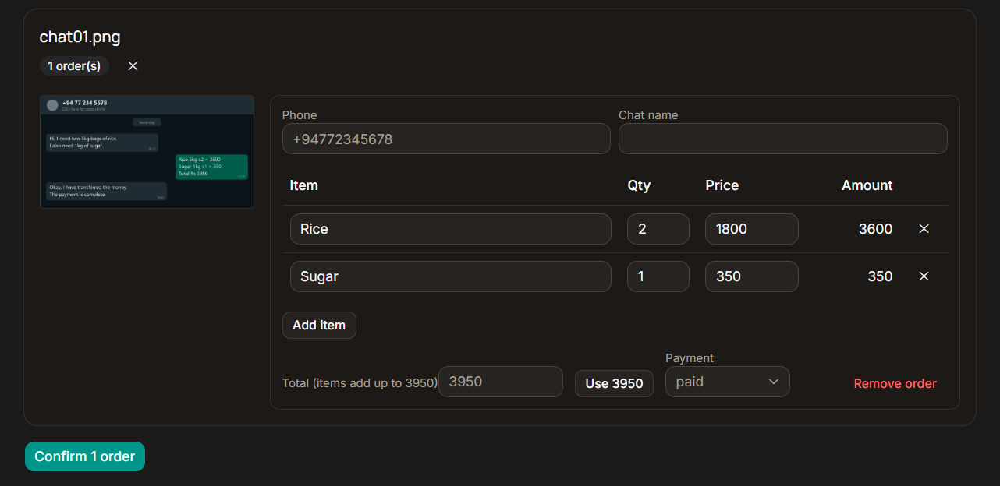
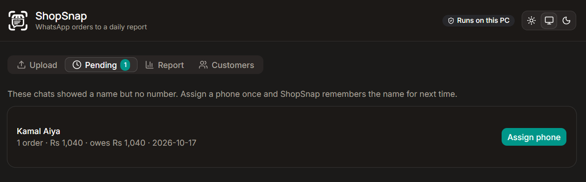
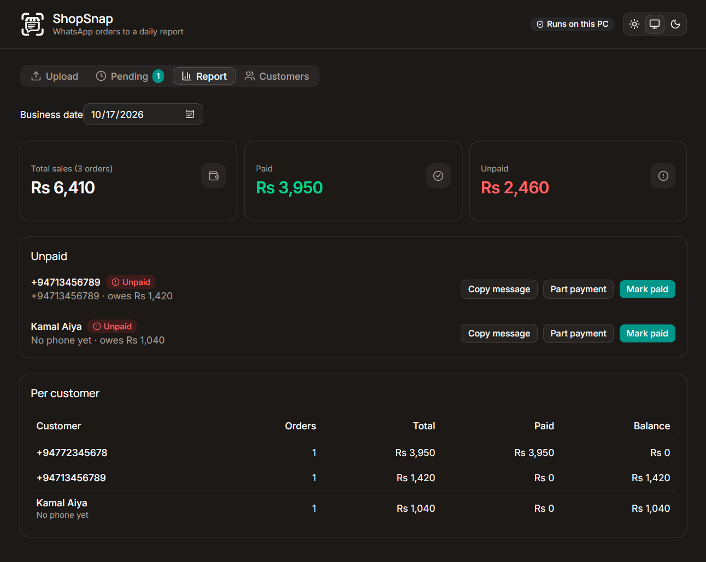

<p align="center">
  <picture>
    <source media="(prefers-color-scheme: dark)" srcset="https://raw.githubusercontent.com/sasmeee/shopsnap/main/public/logo-dark.svg" />
    
  </picture>
</p>

<h1 align="center">ShopSnap</h1>

<p align="center">
  Turn WhatsApp order screenshots into a daily sales report. Built for small shops.<br />
  The AI runs on your own PC. Customer numbers and sales never leave it.
</p>

<p align="center">
  <a href="https://youtu.be/XzX9DlZBfwg"></a>
  
  
  
  <a href="https://github.com/sasmeee/shopsnap/releases"></a>
  
</p>

> Built for the [Hacktoberfest Open-Source AI Challenge, Week 2: Side Hustle](https://dev.to/challenges/hacktoberfest-week2-2026-10-12).  
> The repository was started on October 15, 2026, inside the challenge window.

- **Demo video:** [Watch on YouTube](https://youtu.be/XzX9DlZBfwg)

<!-- After you publish the DEV post, remove these comment marks and put in the real title and link:
- **DEV post:** [Post title](https://dev.to/sasmeee/your-post-slug)
-->

## Screenshots

**Upload and review.** Drop screenshots, then check and fix every order before saving.



**Pending.** Chats that show only a name wait here until you attach a phone number.



**Daily report.** Total sales, who has not paid, and per-customer totals.



All screenshots use fake demo data.

## What it does

1. Drop WhatsApp screenshots and pick the business date.
2. A local vision model reads the chat. A local text model turns it into orders.
3. You review and fix the orders. Nothing is saved until you click Confirm.
4. See total sales, who has not paid, and per-customer totals.
5. Mark orders paid (full or part) and copy a follow-up message for WhatsApp.

Chats that show only a saved name go to a Pending list. You attach a phone number once, and ShopSnap remembers that name for next time.

The app has a light, dark and system theme. Use the buttons in the header.

## Requirements

- [Bun](https://bun.sh) 1.x
- [Ollama](https://ollama.com/download), installed and running
- About 6 GB free disk for the models and 8 GB RAM

## Setup

```bash
git clone https://github.com/sasmeee/shopsnap.git
cd shopsnap
bun install
bun run dev
```

You can also download a version from the [Releases](https://github.com/sasmeee/shopsnap/releases) page.

Open http://localhost:3000. On first run the app downloads the two AI models by itself (one time, needs internet). After that it works offline.

For a production run:

```bash
bun run build
bun run start
```

## Settings (optional)

Put these in `.env.local`:

| Variable       | Default                  | Meaning                         |
| -------------- | ------------------------ | ------------------------------- |
| `VISION_MODEL` | `gemma3:4b`              | Model that reads the screenshot |
| `TEXT_MODEL`   | `qwen2.5:3b`             | Model that extracts orders      |
| `OLLAMA_URL`   | `http://localhost:11434` | Where Ollama runs               |
| `DB_PATH`      | `data/shopsnap.db`       | SQLite file                     |

## How it works

```
screenshot -> resize -> vision model (text) -> text model (JSON)
-> code checks -> you review -> SQLite -> report
```

- Phone number is the only customer ID. A chat name never creates a customer.
- Code, not the model, decides if the chat header is a number or a name.
- Every amount the model returns must appear in the chat text. Items must add up to the total. Failed checks block Confirm.
- "Paid" is only accepted if the chat has payment words. Otherwise it becomes unknown and you decide.
- The same screenshot twice is never counted twice (hash plus order position).
- Only the screenshot hash is stored, never the image.

## Accuracy

Measured on 10 fake screenshots with `bun run eval`. See the DEV post (linked at the top) for the full table and what failed.

```bash
bun run samples   # makes samples/ (fake chats, gitignored)
bun run eval      # runs the pipeline and prints accuracy
```

Real chats are messier than the fake ones. Expect lower numbers. Always use the review screen.

## Privacy

Everything stays on your PC. The database is `data/shopsnap.db` and is gitignored. Demo data is fake.

## Project structure

```
shopsnap/
├── src/
│   ├── app/          Pages, API routes, web app manifest
│   │   └── api/      model, upload, orders, pending, customers, report
│   ├── components/   Screens, pagination, theme toggle, ui/ (shadcn)
│   ├── hooks/        Model setup, pagination
│   └── lib/          Database, order checks, Ollama, phone, reports, messages
├── scripts/          eval.ts, make-samples.ts
├── docs/             README images
└── public/           Logos and app icons
```

## Tech stack

Next.js (App Router, TypeScript), shadcn/ui, Tailwind, SQLite (better-sqlite3), Ollama, zod, libphonenumber-js, sharp.

## Credits and licenses

The code is MIT. The AI models are not part of this repository. Ollama downloads them on first run, and each one keeps its own license:

- [Gemma 3](https://ollama.com/library/gemma3) (screenshot reading), under the Gemma Terms of Use.
- [Qwen2.5 3B](https://ollama.com/library/qwen2.5) (order extraction), under the Qwen Research License.

Read both licenses before you use ShopSnap in a paid or commercial setting.

## Limits

- English and romanized Sinhala ("Singlish") only. Sinhala script is not tested.
- Small models misread some chats. A forced re-read can find an order the first read missed.
- Payment slip reading, desktop packaging and more languages are future work.

## Contact

Sasmitha Ashinsana, [dev.sasmitha@gmail.com](mailto:dev.sasmitha@gmail.com)

## License

[MIT](LICENSE)
